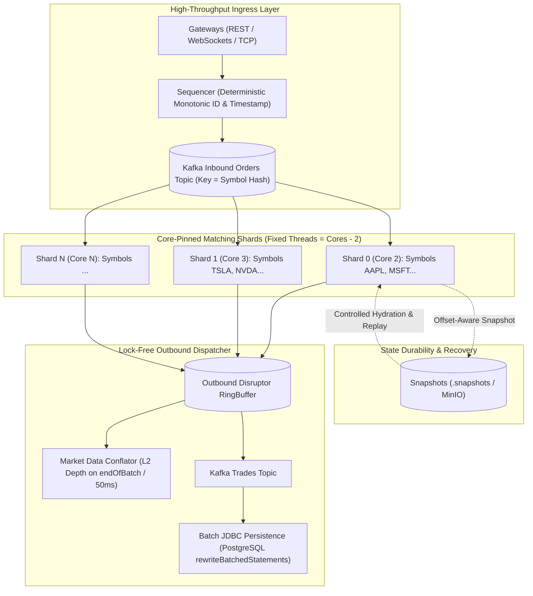
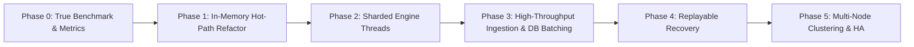

# Challenges Faced While Scaling Apex Exchange Engine

> **Document Type**: Architecture Audit, Post-Mortem & Scaling Roadmap  
> **Target Scale**: 1 Million to 10+ Million Orders per Minute  
> **Key Goal**: Transition from naive symbol-per-thread concurrency to an industry-standard, core-pinned sharded matching engine with microsecond determinism and zero data loss.

---

## 1. Scale Target & Throughput Reality Check

| Scale Target | Sustained Throughput | Peak Burst Headroom (3×) | Target Latency Budget |
| :--- | :--- | :--- | :--- |
| **1 Million Orders / Min** | ~16,667 orders/sec | ~50,000 orders/sec | p99 < 500 µs |
| **10 Million Orders / Min** | ~166,667 orders/sec | ~500,000 orders/sec | p99 < 150 µs |

> [!IMPORTANT]
> In low-latency electronic trading systems, the pure mathematical matching loop in Java is rarely the primary constraint—an optimized, single-threaded matching loop can process millions of price-time matches per second per CPU core. **The primary bottlenecks stem from the auxiliary work executed on or around the hot path**: memory allocation churn, locks, synchronous I/O, full-book scans, and unbounded state tracking.

---

## 2. Industry Architecture Reference: How Production Exchanges Scale

Production financial exchanges and ultra-low-latency platforms (LMAX, Nasdaq INET, LSE Millennium, Aeron Cluster) do not assign one operating system thread per symbol. Instead, they decouple logical symbols from OS threads:

| Principle | Industry Implementation (Nasdaq / LMAX / Aeron) | Current Apex Implementation | Target State in Apex |
| :--- | :--- | :--- | :--- |
| **Thread Model** | Fixed pool of $N$ worker threads pinned to physical cores ($N \approx \text{cores} - 2$). Each shard owns many symbol books. | 1 thread per symbol allocated via `SymbolEngine` with `YieldingWaitStrategy`. | Core-pinned matching shards via consistent hashing (`hash(symbol) % numShards`). |
| **Core Pinning & Isolation** | Isolated OS cores via `isolcpus` / `nohz_full`, thread affinity. Busy-spinning without yielding. | Default OS thread scheduling; threads yield and sleep, causing CPU thrashing. | OpenHFT Java-Thread-Affinity with `BusySpinWaitStrategy` for production. |
| **Sequenced Ingress** | Global sequencer timestamps and writes every inbound message to an append-only journal before matching. | Inbound orders arrive via Kafka with non-deterministic time priority (`System.nanoTime()`). | Sequenced append-only ingress log with deterministic monotonic sequence numbers. |
| **State Determinism** | Zero wall-clock calls or random generators (`UUID`) inside the engine. State is 100% replayable. | `UUID.randomUUID()` generates trade IDs via synchronized `SecureRandom` state. | Monotonically generated trade IDs (`{symbol}-{tradeSeq}`); 100% idempotent replay. |
| **Mechanical Sympathy** | Primitive types, contiguous arrays, no boxing, zero heap allocations on the hot path. | Boxed `Double` prices, `PriorityQueue`, standard `HashMap`, heap object creation. | Intrusive price-level FIFO lists, tick prices (`long`), Agrona primitive maps. |
| **Asynchronous Egress** | L2 depth snapshots conflated per batch (`endOfBatch`). Persistence streamed via non-blocking ring buffers. | L2 depth generated via full-book scan and sent synchronously over STOMP on every order. | Conflated L2 updates (on batch end / throttled 50ms) and outbound Disruptor ring buffer to Kafka. |

---

## 3. Code Audit: Critical Bottlenecks & Severity Matrix

The following table catalogs the specific implementation blockers identified across the current codebase:

| # | Severity | File Reference | Bottleneck Description | Impact at Scale |
| :--- | :--- | :--- | :--- | :--- |
| 1 | 🔴 **Critical** | [`SymbolEngine.java#L101-L105`](file:///c:/Users/satyv/Exchange-Engine/Apex-Exchange-Engine/backend/src/main/java/com/apex/exchange/engine/service/SymbolEngine.java#L101-L105) → [`OrderBook.java#L65-L91`](file:///c:/Users/satyv/Exchange-Engine/Apex-Exchange-Engine/backend/src/main/java/com/apex/exchange/engine/core/OrderBook.java#L65-L91) | **Full-Book Depth Scan on Every Order**: Every order runs `getDepth()`, copying the entire `PriorityQueue` into a `TreeMap<Double, PriceLevelDto>`, boxing `Double` keys, and streaming. | Computational cost scales with total book size ($O(B \log B)$). Synchronous STOMP dispatch blocks the matching thread. |
| 2 | 🔴 **Critical** | [`OrderBook.java#L50-L63`](file:///c:/Users/satyv/Exchange-Engine/Apex-Exchange-Engine/backend/src/main/java/com/apex/exchange/engine/core/OrderBook.java#L50-L63) | **$O(N)$ Order Cancellations**: `PriorityQueue.remove(order)` performs a linear array scan across all resting orders. | Cancellations represent 60–90% of exchange traffic. As resting liquidity grows, cancel latency degrades catastrophically. |
| 3 | 🔴 **Critical** | [`SymbolEngine.java#L108-L111`](file:///c:/Users/satyv/Exchange-Engine/Apex-Exchange-Engine/backend/src/main/java/com/apex/exchange/engine/service/SymbolEngine.java#L108-L111) → [`SnapshotService.java#L30-L49`](file:///c:/Users/satyv/Exchange-Engine/Apex-Exchange-Engine/backend/src/main/java/com/apex/exchange/engine/snapshot/SnapshotService.java#L30-L49) | **Synchronous Snapshot Disk I/O on Hot Path**: Every 1,000 operations, the matching thread halts to serialize JSON and write to disk. | At 100k ops/sec, disk writes occur every 10ms, injecting 1–20ms latency spikes and destroying p99/p99.9 SLAs. |
| 4 | 🔴 **Critical** | [`MatchingEngineManager.java#L75-L79`](file:///c:/Users/satyv/Exchange-Engine/Apex-Exchange-Engine/backend/src/main/java/com/apex/exchange/engine/service/MatchingEngineManager.java#L75-L79) | **Thread Explosion & CPU Thrashing**: 1 spinning Disruptor thread per symbol using `YieldingWaitStrategy`. | 500 active symbols create 500 spinning OS threads, causing scheduler thrashing and cache flushes even when idle. |
| 5 | 🟠 **High** | [`MatchingEngine.java#L65, L122`](file:///c:/Users/satyv/Exchange-Engine/Apex-Exchange-Engine/backend/src/main/java/com/apex/exchange/engine/service/MatchingEngine.java#L65) | **Blocking UUID Generation**: `UUID.randomUUID()` acquires synchronized entropy locks from the OS via `SecureRandom`. | Synchronized OS entropy locks create invisible multi-core contention; non-deterministic IDs break replay deduplication. |
| 6 | 🟠 **High** | [`OrderStatusTracker.java#L15`](file:///c:/Users/satyv/Exchange-Engine/Apex-Exchange-Engine/backend/src/main/java/com/apex/exchange/engine/service/OrderStatusTracker.java#L15) | **Unbounded Memory Leak**: `ConcurrentHashMap<String, OrderStatusResponse>` retains all orders indefinitely without eviction. | At 1M orders/min, accumulates 60M entries/hr, rapidly exhausting JVM heap and triggering fatal `OutOfMemoryError`. |
| 7 | 🟠 **High** | [`PersistenceService.java#L28-L66`](file:///c:/Users/satyv/Exchange-Engine/Apex-Exchange-Engine/backend/src/main/java/com/apex/exchange/engine/persistence/service/PersistenceService.java#L28-L66) | **Single-Row Asynchronous JPA Writes**: Individual `@Async @Transactional` inserts into H2/PostgreSQL with unbounded task queues. | Capped at ~2,000–5,000 writes/sec. Memory backlog accumulates, and trades are permanently lost if the JVM crashes before write. |
| 8 | 🟠 **High** | [`SymbolEngine.java#L128-L134`](file:///c:/Users/satyv/Exchange-Engine/Apex-Exchange-Engine/backend/src/main/java/com/apex/exchange/engine/service/SymbolEngine.java#L128-L134) | **Blocking Trade Publication**: Direct invocation of `tradePublisher.publish()` (`KafkaTemplate.send()`) on the matching thread. | If Kafka's producer buffer saturates, the matching loop halts for up to `max.block.ms` (60 seconds). |
| 9 | 🟡 **Medium** | [`OrderConsumer.java#L17-L20`](file:///c:/Users/satyv/Exchange-Engine/Apex-Exchange-Engine/backend/src/main/java/com/apex/exchange/engine/kafka/OrderConsumer.java#L17-L20) | **Single-Threaded Ingestion**: Default listener concurrency (1 consumer thread for 12 partitions) with Jackson JSON deserialization. | Ingestion bottlenecks at ~25,000 msgs/sec before orders ever reach the matching engine. |
| 10 | 🟡 **Medium** | [`TradeConsumer.java#L27`](file:///c:/Users/satyv/Exchange-Engine/Apex-Exchange-Engine/backend/src/main/java/com/apex/exchange/engine/kafka/TradeConsumer.java#L27) | **High-Volume Synchronous Logging**: `log.info` executed on every trade event. | String concatenation and console/file appender locks degrade consumer throughput under load. |
| 11 | 🟡 **Medium** | Snapshot / Journal Offset Gap | Snapshots save bids/asks but do not record the Kafka topic partition and commit offset. | After a crash, recovery cannot reliably seek Kafka to resume ingestion, causing either data loss or duplicate state mutation. |
| 12 | 🟢 **Low** | [`SymbolEngine.java#L122`](file:///c:/Users/satyv/Exchange-Engine/Apex-Exchange-Engine/backend/src/main/java/com/apex/exchange/engine/service/SymbolEngine.java#L122) | `e.printStackTrace()` used inside catch blocks. | Violates structured logging standards; error details are lost in production log aggregators. |

---

## 4. Correctness, Durability & Observability Vulnerabilities

### A. Offset-Blind Snapshots & Data Loss Window
Snapshots saved in `.snapshots/{symbol}.snapshot.json` capture only the book's active orders and an internal counter. They **do not record the Kafka partition and commit offset**. Upon restart, `EngineRecoveryService` loads the snapshot, but the Kafka consumer resumes from its last committed offset. If orders were committed to Kafka after the snapshot occurred, those orders will either be skipped entirely (permanent data loss) or replayed on top of an already-updated state without idempotency (corrupted state).

### B. Startup Race Condition in Engine Hydration
[`EngineRecoveryService`](file:///c:/Users/satyv/Exchange-Engine/Apex-Exchange-Engine/backend/src/main/java/com/apex/exchange/engine/snapshot/EngineRecoveryService.java) executes on `ApplicationReadyEvent`. However, Spring Kafka listeners automatically start consuming messages during application context initialization *prior* to `ApplicationReadyEvent`. Live order events can arrive and modify the order book concurrently while `EngineRecoveryService` is restoring snapshot state from the main thread, violating the single-writer principle.

### C. Non-Portable Time Priority via `System.nanoTime()`
In [`OrderController.java#L43`](file:///c:/Users/satyv/Exchange-Engine/Apex-Exchange-Engine/backend/src/main/java/com/apex/exchange/engine/controller/OrderController.java#L43), `System.nanoTime()` is assigned as the order timestamp. `nanoTime` measures elapsed time since an arbitrary JVM start reference point. It has no meaning across JVM restarts, cannot be synchronized across multiple server nodes, and produces invalid comparisons when restoring historical snapshots.

### D. Benchmark Measurement Inaccuracy
In [`LoadTestService.java#L45-L72`](file:///c:/Users/satyv/Exchange-Engine/Apex-Exchange-Engine/backend/src/main/java/com/apex/exchange/load/LoadTestService.java#L45-L72), the benchmark timer stops as soon as orders are published to the Disruptor ring buffer (`manager.submitOrder()`), **not** when orders have actually been processed by the matching engine. The reported throughput measures queue ingestion speed rather than matching execution speed, and `avgLatencyUs` was calculated as $\frac{\text{Duration}}{\text{Total Orders}}$ (inverse throughput), failing to capture true latency distribution percentiles.

---

## 5. Target Architecture: Sharded Core-Pinned Engine



### High-Performance OrderBook Memory Layout

```text
OrderBook (Per Symbol, purely single-threaded within its assigned Shard)
 ├── bids: Sorted Price-Level Table (Tick-indexed)
 │     └── PriceLevel { long priceTicks; long totalQuantity; int orderCount; Order head, tail; }
 ├── asks: Sorted Price-Level Table (Tick-indexed)
 ├── bestBidPrice: long (cached tick)
 ├── bestAskPrice: long (cached tick)
 └── orderIndex: Agrona Long2ObjectHashMap<Order> (O(1) direct cancellation)

Order (Intrusive Doubly-Linked List Node):
 ├── long orderId
 ├── long priceTicks
 ├── long remainingQty
 ├── Order prev, next (Intrusive links for O(1) removal without heap traversal)
 └── PriceLevel parentLevel
```

---

## 6. Phased Implementation Roadmap



### Phase 0: True Benchmark & Telemetry Instrumentation
* **Halt Clock on Completion**: Stop the benchmark timer only when all worker engines report that their order queues are completely drained and all orders matched.
* **Realistic Order Flow**: Configurable multi-symbol distribution, price spreads around a mid price, and realistic order type mixes (e.g., 60% Limit, 10% Market, 30% Cancel).
* **Percentile Latency Histograms**: Record true end-to-end latency distributions (p50, p95, p99, p99.9) using HdrHistogram, replacing the misleading `avgLatencyUs` metric.
* **Baseline Recording**: Record verified pre-optimization numbers in `ACTIVE_STATUS.md`.

### Phase 1: In-Memory Hot-Path Refactor (Single-Node Maximization)
* **$O(1)$ OrderBook Data Structures**:
  * Replace `PriorityQueue` with a sorted price map pointing to `PriceLevel` nodes.
  * Each `PriceLevel` maintains an intrusive doubly-linked list (`prev`/`next` on `Order`) for $O(1)$ appends and removals.
  * Secondary index map provides instantaneous $O(1)$ cancellations.
  * Prices represented as integer ticks (`long priceTicks`), eliminating floating-point errors.
* **Market Data Conflation**:
  * Broadcast L2 depth only on Disruptor batch completion (`endOfBatch == true`) or throttled to fixed intervals (e.g., once every 50ms), eliminating per-order full-book scans.
* **Asynchronous Non-Blocking Snapshots**:
  * The matching thread takes a structural shallow copy; JSON serialization and disk writes execute on a dedicated background I/O thread.
* **Deterministic Sequencing**:
  * Monotonically incrementing per-shard trade IDs (`{symbol}-{tradeSeq}`); replace `System.nanoTime()` with sequence numbers for deterministic time priority.
* **Bounded Order Tracker**:
  * Implement TTL-based eviction or a circular ring-buffer cache for terminal orders (`FILLED`/`CANCELLED`), delegating historical lookups to the database.

### Phase 2: Sharded Core-Pinned Engine Architecture
* **Fixed Shard Thread Pool**: Replace 1-thread-per-symbol with $N$ worker shards ($N = \text{physical CPU cores} - 2$).
* **Deterministic Shard Routing**: Route symbols to shards via consistent hashing (`hash(symbol) % numShards`).
* **Configurable Wait Strategies**: `BusySpinWaitStrategy` with thread affinity for bare-metal production; `Yielding` or `Blocking` for local development.

### Phase 3: High-Throughput Ingestion & Database Batching
* **Kafka Listener Concurrency**: Scale `OrderConsumer` concurrency to match partition counts; enable batch message consumption (`batch-listener: true`).
* **Batch JDBC Persistence**: Replace single-row `@Async` JPA saves with bulk JDBC batch inserts (`rewriteBatchedStatements=true` in PostgreSQL).
* **Commit on Write**: Commit Kafka offsets only *after* database batches succeed, guaranteeing at-least-once persistence with automatic backpressure.
* **Binary Serialization**: Transition high-throughput topics to Protobuf or Simple Binary Encoding (SBE) to eliminate JSON reflection overhead.

### Phase 4: Deterministic Replayable Recovery
* **Offset-Aware Snapshots**: Persist the exact Kafka partition offsets and engine sequence counters inside the snapshot file.
* **Controlled Hydration Lifecycle**: Keep Kafka listeners paused on startup (`autoStartup = false`). Load snapshots, seek consumer offsets to `snapshot.offset + 1`, replay missing delta events, and then accept live traffic.
* **Idempotent Replay**: Deterministic trade IDs allow downstream consumers to detect and drop duplicate executions during recovery replay.

### Phase 5: Horizontal Multi-Node Clustering & High Availability (HA)
* **Cluster Partition Assignment**: Scale across independent engine nodes using Kafka partition group balancing.
* **Active-Standby Replicas**: Standby engines trail the primary order log in read-only mode for sub-second failover.
* **Distributed Cloud Snapshots**: Store periodic snapshots in distributed object storage (MinIO, AWS S3, or GCS).

---

## 7. Open Architectural Decisions

Before executing the implementation phases, align on these key requirements:
1. **Target Rate**: Design for **1M orders/min (~17k ops/sec sustained)** vs. **10M orders/min (~167k ops/sec sustained)**.
2. **Symbol Breadth**: Few heavily traded symbols (5–20) vs. broad multi-asset distribution (500–5,000 symbols).
3. **Durability Guarantee**: Hard zero-loss guarantee (prioritizing Phase 4) vs. high-throughput simulation mode.
4. **Order Ingestion Protocol**: Retain HTTP REST gateways vs. introducing direct high-speed WebSocket or TCP socket entry points.
