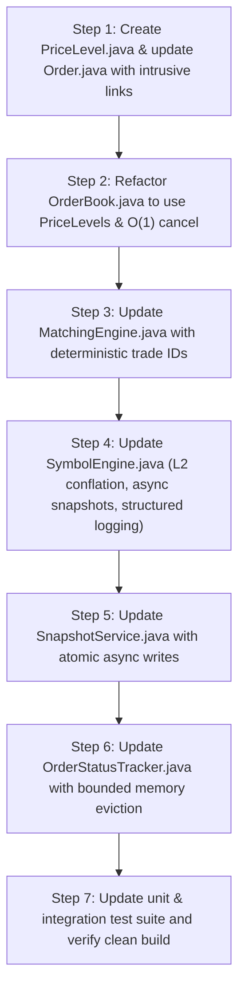

# Phase 1: Critical Hot-Path Optimization & Architecture Plan

> **Document Type**: Detailed Implementation Plan  
> **Parent Architecture Document**: [CHALLENGES_FACED_WHILE_SCALING.md](file:///c:/Users/satyv/Exchange-Engine/Apex-Exchange-Engine/CHALLENGES_FACED_WHILE_SCALING.md)  
> **Target Milestone**: Phase 1 — In-Memory Hot-Path Maximization  
> **Status**: Approved for Execution

---

## 1. Executive Summary & Objectives

The primary objective of Phase 1 is to eliminate every known algorithmic bottleneck, CPU lock, and blocking I/O operation on the **hot execution path** of the Apex Exchange Engine. 

By restructuring the in-memory order book into intrusive price levels, conflating market data broadcasts, offloading snapshot disk writes, generating deterministic trade IDs, and bounding memory in the status tracker, the engine will achieve sub-microsecond per-order processing and scale safely toward **millions of orders per minute**.

---

## 2. Target Bottlenecks (Ordered by Criticality)

| Priority | Bottleneck ID | Target Component | Core Problem | Solution in Phase 1 |
| :--- | :--- | :--- | :--- | :--- |
| 🔴 **Critical #1** | 2 | [`OrderBook.java`](file:///c:/Users/satyv/Exchange-Engine/Apex-Exchange-Engine/backend/src/main/java/com/apex/exchange/engine/core/OrderBook.java) | $O(N)$ order cancellations via `PriorityQueue.remove(order)` | Intrusive doubly-linked list (`PriceLevel`) with secondary index for true **$O(1)$ cancellation**. |
| 🔴 **Critical #2** | 1 | [`SymbolEngine.java`](file:///c:/Users/satyv/Exchange-Engine/Apex-Exchange-Engine/backend/src/main/java/com/apex/exchange/engine/service/SymbolEngine.java) & [`OrderBook.java`](file:///c:/Users/satyv/Exchange-Engine/Apex-Exchange-Engine/backend/src/main/java/com/apex/exchange/engine/core/OrderBook.java) | Full-book depth scans (`TreeMap` + stream) & synchronous WebSocket broadcast on every order | Pre-aggregated price level depth ($O(\text{depth})$) + **depth conflation** (broadcast on `endOfBatch` & throttled to 50ms). |
| 🔴 **Critical #3** | 3 | [`SymbolEngine.java`](file:///c:/Users/satyv/Exchange-Engine/Apex-Exchange-Engine/backend/src/main/java/com/apex/exchange/engine/service/SymbolEngine.java) & [`SnapshotService.java`](file:///c:/Users/satyv/Exchange-Engine/Apex-Exchange-Engine/backend/src/main/java/com/apex/exchange/engine/snapshot/SnapshotService.java) | Synchronous JSON serialization & disk writes every 1,000 ops on the worker thread | **Asynchronous snapshot offloading**: worker captures in-memory state; dedicated executor handles atomic disk write (`.tmp` $\to$ `.snapshot.json`). |
| 🟠 **High #4** | 5 | [`MatchingEngine.java`](file:///c:/Users/satyv/Exchange-Engine/Apex-Exchange-Engine/backend/src/main/java/com/apex/exchange/engine/service/MatchingEngine.java) | `UUID.randomUUID()` acquires synchronized OS entropy locks via `SecureRandom` | **Deterministic monotonic trade IDs** (`{symbol}-T{tradeSeq}`) with zero thread contention. |
| 🟠 **High #5** | 6 | [`OrderStatusTracker.java`](file:///c:/Users/satyv/Exchange-Engine/Apex-Exchange-Engine/backend/src/main/java/com/apex/exchange/engine/service/OrderStatusTracker.java) | Unbounded memory leak: terminal orders (`FILLED`/`CANCELLED`) never evicted | **Bounded LRU / TTL eviction** for terminal orders, delegating historical queries to database. |
| 🟢 **Defensive #6** | 12 | [`SymbolEngine.java`](file:///c:/Users/satyv/Exchange-Engine/Apex-Exchange-Engine/backend/src/main/java/com/apex/exchange/engine/service/SymbolEngine.java) | `e.printStackTrace()` used in catch blocks | Structured `slf4j` logging (`log.error`). |

---

## 3. Detailed Architectural Specifications

### 3.1. `PriceLevel.java` (New Core Data Structure)
* **Package**: `com.apex.exchange.engine.core`
* **Purpose**: Holds an intrusive FIFO doubly-linked list of resting `Order` nodes at an exact price level.
* **Fields**:
  ```java
  private final double price;
  private long totalQuantity;
  private int orderCount;
  private Order head;
  private Order tail;
  ```
* **Key Methods**:
  * `addOrder(Order order)`: Appends to `tail` in $O(1)$. Updates `totalQuantity` and `orderCount`. Links `order.prev = tail`, `order.next = null`, `order.parentLevel = this`.
  * `removeOrder(Order order)`: Unlinks node in $O(1)$ from `head`, `tail`, or middle. Updates `totalQuantity` and `orderCount`.
  * `peekHead()`: Returns top priority order in $O(1)$.
  * `pollHead()`: Unlinks and returns top priority order in $O(1)$.
  * `isEmpty()`: Checks if `orderCount == 0`.

### 3.2. `Order.java` (Intrusive Node Integration)
* **Package**: `com.apex.exchange.engine.model`
* **Changes**:
  * Add intrusive node pointers:
    ```java
    @JsonIgnore
    private Order prev;
    @JsonIgnore
    private Order next;
    @JsonIgnore
    private PriceLevel parentLevel;
    ```
  * Add helper method:
    ```java
    public void removeFromLevel() {
        if (parentLevel != null) {
            parentLevel.removeOrder(this);
            parentLevel = null;
        }
    }
    ```
  * Add getters and setters for intrusive pointers (all marked with `@JsonIgnore` to prevent Jackson serialization cycles).

### 3.3. `OrderBook.java` ($O(1)$ Redesign)
* **Package**: `com.apex.exchange.engine.core`
* **State**:
  ```java
  private final TreeMap<Double, PriceLevel> buyLevels = new TreeMap<>(Comparator.reverseOrder());
  private final TreeMap<Double, PriceLevel> sellLevels = new TreeMap<>(Comparator.naturalOrder());
  private final Map<String, Order> activeOrders = new HashMap<>();
  ```
* **Cancellations**:
  ```java
  public boolean cancelOrder(String orderId) {
      Order order = activeOrders.remove(orderId);
      if (order == null) return false;
      order.cancel();
      order.removeFromLevel();
      // Clean up empty price level if no orders remain at this price
      cleanEmptyLevel(order.getSide(), order.getPrice());
      return true;
  }
  ```
* **$O(\text{depth})$ Market Data Depth Aggregation**:
  ```java
  public OrderBookDepthDto getDepth(String symbol, int depth) {
      List<PriceLevelDto> bids = collectLevels(buyLevels, depth);
      List<PriceLevelDto> asks = collectLevels(sellLevels, depth);
      return new OrderBookDepthDto(symbol, System.currentTimeMillis(), bids, asks);
  }
  ```
  Directly reads `level.getTotalQuantity()` and `level.getOrderCount()` from the first $N$ entries of the `TreeMap`. No allocations, no whole-book streaming.

### 3.4. `MatchingEngine.java` (Deterministic Matching)
* **Package**: `com.apex.exchange.engine.service`
* **State**:
  * `private long tradeSequence = 0;`
* **Trade ID Generation**:
  ```java
  String tradeId = buyOrder.getSymbol() + "-T" + (++tradeSequence);
  ```
* **Matching Loop**:
  * Peek `orderBook.bestAsk()` and `orderBook.bestBid()`.
  * Deduct quantities from resting head orders; if head order quantity reaches 0, poll it and remove from `activeOrders`.

### 3.5. `SymbolEngine.java` (Market Data Conflation & Async Snapshots)
* **Package**: `com.apex.exchange.engine.service`
* **Conflation Logic**:
  * Store `long lastDepthBroadcastTime = 0;`
  * In `handleOrderEvent(OrderEventHolder holder, long sequence, boolean endOfBatch)`:
    ```java
    long now = System.currentTimeMillis();
    if (marketDataBroadcaster != null && endOfBatch && (now - lastDepthBroadcastTime >= DEPTH_BROADCAST_INTERVAL_MS)) {
        OrderBookDepthDto depthDto = matchingEngine.getOrderBook().getDepth(symbol, 10);
        marketDataBroadcaster.broadcastDepth(depthDto);
        lastDepthBroadcastTime = now;
    }
    ```
* **Async Snapshotting**:
  * Maintain a dedicated daemon `ExecutorService snapshotExecutor = Executors.newSingleThreadExecutor(...)`.
  * Every 1,000 operations, take an in-memory snapshot structure and offload disk persistence to `snapshotExecutor`.

### 3.6. `SnapshotService.java` (Atomic File Writes)
* **Package**: `com.apex.exchange.engine.snapshot`
* **Atomic File Write**:
  * Write JSON to temporary file `{symbol}.snapshot.json.tmp`.
  * Atomically rename `tmp` file to `{symbol}.snapshot.json` via `Files.move(..., StandardCopyOption.ATOMIC_MOVE)` to ensure a crash mid-write never leaves a corrupt snapshot.

### 3.7. `OrderStatusTracker.java` (Bounded Memory Eviction)
* **Package**: `com.apex.exchange.engine.service`
* **State**:
  * Maintain active orders in `ConcurrentHashMap`.
  * For terminal orders (`FILLED`, `CANCELLED`), move to a bounded LRU cache or evict after a retention period, delegating historical queries to `HistoryController` (which reads from database).

---

## 4. Execution Roadmap



---

## 5. Verification Plan

1. **Automated Unit & Integration Tests**:
   * Compile and run the full test suite:
     ```powershell
     cd backend
     .\mvnw.cmd test
     ```
   * Add dedicated `PriceLevelTest` verifying $O(1)$ operations and edge cases (head, tail, single node, middle removal).
2. **Cancellation Verification**:
   * Verify cancellation of orders in the middle of price levels executes in $O(1)$ and properly updates book depth.
3. **Conflation & Snapshot Integrity**:
   * Verify that snapshots are written cleanly and engine recovery continues to restore order books accurately.
